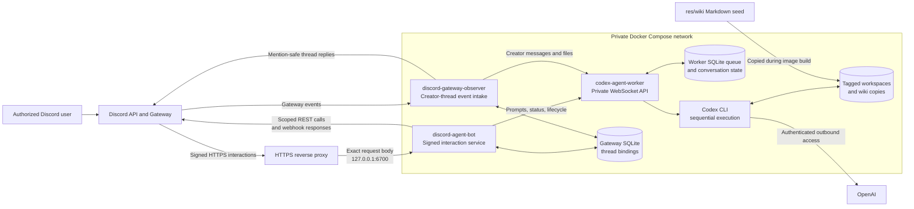

# Project Overview and Getting Started

## What this project does

Discord Agent Bot connects authorized Discord users to persistent Codex agents running inside a private Docker service. It supports signed slash-command interactions, creator-owned agent threads, a Markdown knowledge base, persistent tagged workspaces, bounded file exchange, and moderator operations for inspecting and managing agents.

The project is currently a development proof of concept. Its authorization checks and container boundaries are implemented and tested offline, but a deployment still requires a reviewed Discord application, HTTPS reverse proxy, credential handling, retention policy, and authorized live validation.

## Architecture



### Runtime components

| Component | Responsibility | Exposure and data |
| --- | --- | --- |
| `discord-agent-bot` | Verifies raw Discord request signatures, applies authorization policy, dispatches commands, and completes deferred responses. | Container port `8080` is published only as host loopback `127.0.0.1:6700`. It receives the Discord secrets file read-only. |
| `discord-gateway-observer` | Receives creator messages and thread closure events for active agent-thread bindings. | No published port. It shares the Discord secrets file and the binding database with the interaction service. |
| `codex-agent-worker` | Owns the durable queue, tagged conversations, workspace lifecycle, status reporting, file validation, and Codex CLI execution. | Private Compose port `8090`; no Discord credentials, host project mount, Docker socket, or published host port. |
| HTTPS reverse proxy | Terminates public TLS and forwards Discord's interaction route without changing the signed request body. | External deployment component, not included in Compose. |
| Named volumes | Preserve Codex login state, worker state, tagged workspaces, and Discord thread bindings. | Remain after ordinary `docker compose down`; deleting volumes deletes this state. |

### Request paths

Slash commands arrive through `POST /discord/interactions`. The HTTP service verifies the Ed25519 signature against the exact raw body before parsing JSON, then checks the configured guild, destination, user, role, and moderator policy. Deterministic commands answer directly. Agent commands are acknowledged as deferred work, submitted to the private worker, and completed through Discord's interaction webhook.

An `/agent_thread` command creates a public Discord child thread and stores a binding between its verified creator and one explicit agent tag. The Gateway observer forwards only that creator's ordinary messages and supported attachments. Messages from other users, bots, and webhooks are ignored. Archiving or deleting the Discord thread closes the binding without deleting its persistent agent workspace.

The worker processes one Codex turn at a time across all tags. Each tag has its own conversation and `/workspaces/<tag>` directory, initialized from the generic workspace template and the Markdown files under `res/wiki/`. Tags provide continuity, but tags sharing one worker are not separate security boundaries.

## Implemented features

### Discord and security boundary

- Raw-body Ed25519 verification before interaction parsing or dispatch.
- Explicit guild, channel/thread, user, role, and moderator-role allowlists.
- Duplicate interaction rejection and bounded request handling.
- Private responses by default, with an explicit `public` option.
- Automatic mentions disabled for echoed, retrieved, and generated content.
- Guild-scoped command registration with confirmation before bulk replacement.
- Scoped Discord REST access instead of a general Discord API capability.

### Commands

| Area | Commands | Implemented behavior |
| --- | --- | --- |
| Basic and diagnostics | `/hello`, `/echo`, `/millis`, `/add`, `/dev_public`, `/dev_deferred`, `/help` | Deterministic responses, visibility behavior, deferred-response exercise, and registry-derived help. |
| Scoped history | `/dev_history` | Reads at most ten recent messages from the invoking permitted channel or thread. |
| Agent prompts | `/respond`, `/prompt` | Sends a prompt to the default worker or to an explicitly selected persistent agent tag. |
| Knowledge and summaries | `/explain`, `/summarize` | Uses the workspace wiki for explanations or summarizes up to 100 recent messages around a supplied topic. |
| Agent threads | `/agent_thread` | Configures a tagged agent, creates a creator-owned public thread, and persists the binding. |
| Agent catalog and lifecycle | `/agent_list`, `/agent_config`, `/agent_reset`, `/agent_delete` | Lists tags and provides moderator-only model configuration, workspace reset, and full tagged-agent deletion. |
| Agent observation | `/agent_report` | Shows moderator-only queue, outcome, activity-time, runtime-profile, and recent-command metadata for one tag without invoking Codex. |

### Agent execution and storage

- Durable SQLite job queue with recovery and idempotent request handling.
- Persistent Codex conversations and workspaces per validated agent tag.
- Optional fixed-purpose agent profiles in `config/config_agents.json`.
- Runtime model and reasoning configuration through reviewed command choices.
- Generic workspace seeding plus a deployment-specific Markdown wiki.
- Bounded inbound text, document, image, and structured-data attachments in creator-owned threads.
- Validated outbound attachments, including ZIP output, from a request-specific upload directory.
- Read-only container roots for the Gateway observer and worker, non-root runtime users, bounded temporary filesystems, and explicit writable volumes.
- Health checks for all three Compose services and redacted operational logging.

## Current boundaries

- The worker serves all tags through one sequential queue and one shared container boundary.
- The private worker interface currently relies on Compose network isolation rather than application-layer authentication or TLS.
- Agent tags separate workspaces and conversations but do not isolate mutually untrusted users.
- Prompts, answers, workspace changes, and selected Discord metadata persist until an operator or moderator removes them; a complete production retention policy is not implemented.
- Deferred interaction delivery and Gateway resume state are not fully restart-safe.
- The offline suite does not validate Discord configuration, live message delivery, DNS, TLS, reverse-proxy behavior, Codex account access, or production security.

## Getting started

### 1. Prerequisites

Install Docker with Docker Compose support. Local offline development additionally needs Python 3. A live setup needs:

- a Discord application with a bot;
- its application ID, public key, and bot token;
- the target Discord guild ID;
- IDs for the channels, threads, users, roles, and moderator roles you intend to allow;
- an HTTPS domain and reverse proxy for Discord's interaction callback;
- a ChatGPT account with Codex access for the worker's device login.

The Discord client secret is not needed. Keep every real credential and deployment ID out of tracked files.

### 2. Create the local Discord secrets file

Create the ignored directory `secrets/`, then create `secrets/secrets.json` with this structure:

```json
{
	"DISCORD_APPLICATION_ID": "",
	"DISCORD_PUBLIC_KEY": "",
	"DISCORD_BOT_TOKEN": "",
	"DISCORD_GUILD_ID": "",
	"DISCORD_ALLOWED_CHANNEL_IDS": [],
	"DISCORD_ALLOWED_THREAD_IDS": [],
	"DISCORD_ALLOWED_USER_IDS": [],
	"DISCORD_ALLOWED_ROLE_IDS": [],
	"DISCORD_MOD_ROLE_IDS": []
}
```

Fill the first four fields with the application ID, public key, bot token, and guild ID from your Discord application and target server. Add the permitted destination and actor IDs to their corresponding arrays. Discord IDs remain quoted JSON strings. Empty actor allowlists permit any actor who passes the other configured checks; use explicit allowlists for a controlled deployment. The service mounts this file read-only at runtime, and Git and Docker build rules exclude it from source history and image layers.

### 3. Prepare the knowledge base

The tracked [`res/wiki/MOCKUP.md`](../res/wiki/MOCKUP.md) demonstrates the general knowledge-base format with notes about anime culture in Japan. Add deployment-specific Markdown pages beside it. Additional files under `res/wiki/` are ignored by Git but copied into the worker image, so never place credentials or private material there unless its use and retention have been explicitly approved.

Rebuild the worker whenever the wiki seed changes. Existing agent workspaces keep their current wiki; baseline updates do not silently overwrite maintained workspace content.

### 4. Build the images

From the repository root:

```sh
docker compose build
```

This builds the Discord service image and the isolated Codex worker image. It does not register commands, contact a Discord server, or sign in to Codex.

### 5. Authenticate the Codex worker

Run the device-login helper:

```sh
sh scripts/codex_login.sh
```

Open the displayed URL in a trusted browser, enter the short-lived code, and sign in with the intended ChatGPT account. Credentials are stored in the Compose-managed `codex-home` volume and must be treated like a password store.

### 6. Start the private services

```sh
docker compose up --detach --build --wait
docker compose ps
```

Verify the loopback health endpoint:

```sh
curl http://127.0.0.1:6700/health
```

The Gateway observer and worker have no published host ports.

### 7. Connect the Discord interaction endpoint

Configure your HTTPS reverse proxy to forward only the public interaction route to:

```text
http://127.0.0.1:6700/discord/interactions
```

The proxy must preserve the exact request body. In the Discord application's settings, set the Interactions Endpoint URL to the corresponding public HTTPS URL, for example:

```text
https://agents.example.com/discord/interactions
```

Use your own controlled domain. The interaction service uses the public key stored in `secrets/secrets.json` to verify requests signed by Discord.

### 8. Register the guild commands

The application ID, guild ID, and bot token already placed in `secrets/secrets.json` are used by the registration utility. Run:

```sh
docker compose run --rm --no-deps discord-agent-bot \
	python /app/scripts/register_commands.py \
	/run/secrets/discord-agent-bot.json
```

Review the prompt before confirming. Registration replaces the complete command set for the configured guild; it does not create global commands.

The bot must already be present in the guild with only the permissions needed for the features you will use. Agent threads need permission to view the parent channel, create public threads, send messages in threads, and attach files. History features need permission to view the destination and read message history. The Gateway observer also requires the `GUILDS`, `GUILD_MESSAGES`, and Message Content intents.

### 9. Validate in a dedicated test channel

Start with non-confidential content in a narrowly allowed channel:

1. Run `/hello` and confirm the default response is private.
2. Confirm the command is rejected from an unlisted channel or unauthorized account.
3. Run `/respond` with a simple prompt to validate the worker login and queue.
4. Run `/explain` against a topic covered by the mock wiki.
5. Create an `/agent_thread`, send a message as its creator, and confirm other users are ignored.
6. Archive the thread and confirm it no longer forwards messages.

Offline tests and these smoke checks do not establish production security. Review [Security and Operations](SECURITY_AND_OPERATIONS.md) and [Docker Deployment](DEPLOYMENT_DOCKER.md) before handling confidential data.

### 10. Stop the services

```sh
docker compose down
```

Do not add `--volumes` unless you deliberately intend to erase the worker login, queue, conversations, tagged workspaces, and Discord thread bindings.

## Local offline development

On Windows PowerShell, create or activate the project-local environment and run the offline test suite:

```powershell
. .\scripts\activate_venv.ps1
python -m pytest
```

On Linux or macOS:

```sh
. ./scripts/activate_venv.sh
python -m pytest
```

The suite uses synthetic signing keys and fake worker boundaries. It requires no Discord credentials and does not register commands or send live messages.

## Further documentation

- [Docker deployment and operations](DEPLOYMENT_DOCKER.md)
- [Security and operations](SECURITY_AND_OPERATIONS.md)
- [Discord agent threads](DISCORD_AGENT_THREADS.md)
- [Codex worker integration](CODEX_AGENT_INTEGRATION.md)
- [Codex worker WebSocket protocol](CODEX_WORKER_WEBSOCKET_PROTOCOL.md)
- [Project requirements](PROJECT_REQUIREMENTS.md)
